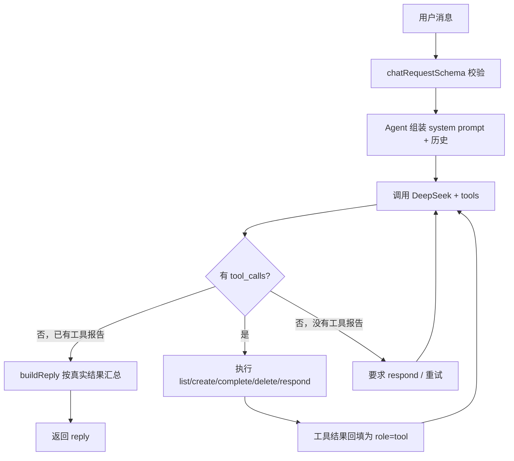

# Todo Agent

[](https://github.com/ybc-0211/-ai-agent-/actions/workflows/ci.yml)

> 基于 DeepSeek Function Calling 的中文待办清单智能体。

## 项目介绍

Todo Agent 是一个可本地运行的中文 AI 待办清单智能体。用户可以用中文与它对话，完成待办任务的创建、查询、完成和删除；任务会持久化到本地 JSON 文件，刷新页面或重启服务后仍可查询。

项目包含一个 React 聊天界面、一个 Express 服务端、一个任务 REST API，以及基于 DeepSeek Chat Completions 的 Agent 循环。

## 项目背景

本项目最初来自 [TokeNow/todo-agent](https://github.com/TokeNow/todo-agent) 的待办清单编程题。初始项目中的智能体只会返回固定回复，任务 API 和聊天界面已经预先提供。

在此基础上，本项目实现了：

- DeepSeek Function Calling；
- 四个任务操作工具；
- 服务端任务名称匹配与歧义处理；
- 先查询再修改；
- 基于真实工具结果的成功校验与安全兜底。

界面中的「小明智能体」保留了原始题目的角色名，项目名称统一为 **Todo Agent**。

当前仓库：<https://github.com/ybc-0211/-ai-agent->

## 核心功能

| 功能              | 说明                                                       |
| ----------------- | ---------------------------------------------------------- |
| 创建任务          | 从中文对话中提取任务标题并创建待办                         |
| 查询任务          | 列出全部任务及完成状态                                     |
| 标记完成          | 按用户所说的任务名称匹配真实任务并标记完成                 |
| 删除任务          | 按名称匹配真实任务并永久删除                               |
| 同名/相似任务处理 | 多个候选时返回歧义，要求用户确认；支持用户明确指定“第几条” |
| 先查询再修改      | 完成或删除前必须先调用任务查询工具                         |
| 真实结果校验      | 成功回复只来自服务端对真实工具执行结果的确认               |
| 本地持久化        | 任务保存到 `data/tasks.json`，使用临时文件 + 原子替换      |
| 安全兜底          | 模型漏调用工具、工具失败或参数错误时不会虚报成功           |
| 调用限制          | 单轮最多 6 次模型步骤、12 次工具调用                       |

## 对话示例

以下为真实运行时的六轮对话摘要：

| 用户             | Agent 结果                             |
| ---------------- | -------------------------------------- |
| 帮我记一下买牛奶 | 已创建任务「买牛奶」                   |
| 再记一条取快递   | 已创建任务「取快递」                   |
| 我有哪些任务？   | 列出两条未完成任务                     |
| 牛奶买好了       | 「买牛奶」标记为完成，「取快递」仍待办 |
| 取快递这条删掉吧 | 实际删除「取快递」                     |
| 再给我看看清单   | 只剩已完成的「买牛奶」                 |

任务数据在服务重启后仍然存在。当前没有内置截图或视频演示，以上内容来自实际对话记录。

复现方式：启动服务后按上表顺序发送消息；每轮会显示当前清单。也可以直接调用 `GET /api/tasks` 查看持久化结果。

## 技术栈

| 类别          | 技术                                                 |
| ------------- | ---------------------------------------------------- |
| 语言          | TypeScript、TSX、CSS、HTML                           |
| 运行环境      | Node.js 24.12+，ESM                                  |
| 服务端        | Express 5                                            |
| 前端          | React 19 + react-dom                                 |
| AI            | DeepSeek Chat Completions，默认模型 `deepseek-flash` |
| AI SDK        | `openai`（OpenAI 兼容接口）                          |
| 参数校验      | zod                                                  |
| 测试          | Node.js 内置 `node:test`                             |
| 构建          | esbuild                                              |
| 类型检查      | TypeScript `tsc --noEmit`                            |
| Lint / 格式化 | oxlint / oxfmt                                       |
| 存储          | 本地 JSON 文件，无数据库                             |

## 项目架构概览

```mermaid
flowchart LR
  Browser[React Chat UI] -->|POST /api/chat| API[Express /api/chat]
  API -->|reply(messages)| Agent[Todo Agent]
  Agent -->|Chat Completions + tools| DeepSeek[DeepSeek API]
  DeepSeek -->|tool_calls / content| Agent
  Agent -->|list/create/complete/delete| Store[(TaskStore<br/>data/tasks.json)]
  Agent -->|reply| Browser
  Store -->|tasks| Agent

  Other[外部 API 客户端] -->|/api/tasks| REST[Task REST API]
  REST --> Store
```

任务 REST API（与 Agent 共用同一个 TaskStore）：
`/api/tasks → server/tasks.ts → server/task-store.ts`

核心文件：

| 文件                                         | 作用                                            |
| -------------------------------------------- | ----------------------------------------------- |
| [server/index.ts](server/index.ts)           | 创建 TaskStore、Agent 和 Express 应用，启动服务 |
| [server/app.ts](server/app.ts)               | `/api/chat`、任务 API、静态资源与错误处理       |
| [server/agent.ts](server/agent.ts)           | Agent 主循环、工具执行、名称匹配、最终回复      |
| [server/model.ts](server/model.ts)           | DeepSeek 客户端与模型配置                       |
| [server/tasks.ts](server/tasks.ts)           | 任务 REST API 的输入校验和响应                  |
| [server/task-store.ts](server/task-store.ts) | JSON 任务存储与原子写入                         |
| [shared/chat.ts](shared/chat.ts)             | 前后端共享的消息类型与请求 schema               |
| [src/App.tsx](src/App.tsx)                   | 聊天界面、发送逻辑                              |

更详细的架构说明见 [docs/architecture.md](docs/architecture.md)。

## 项目结构

```text
todo-agent/
├─ .github/workflows/ci.yml   GitHub Actions 工作流
├─ docs/
│  └─ architecture.md         架构与工具协议说明
├─ public/                    静态 HTML/CSS/图标
├─ server/
│  ├─ index.ts                服务端入口与依赖装配
│  ├─ app.ts                  Express、聊天接口、任务路由
│  ├─ agent.ts                Agent 循环、工具、匹配、回复
│  ├─ model.ts                DeepSeek 客户端与超时
│  ├─ tasks.ts                任务 REST API
│  ├─ task-store.ts           JSON 任务存储
│  ├─ agent.test.ts           Agent 测试
│  └─ app.test.ts             API/聊天测试
├─ shared/chat.ts             前后端共享消息 schema
├─ src/                       React 聊天前端
├─ .env.example               环境变量占位示例
├─ .gitignore
├─ .oxfmtrc.json
├─ .oxlintrc.json
├─ package.json               脚本与依赖
├─ package-lock.json
├─ tsconfig.json              TypeScript 配置
├─ AGENTS.md
├─ SUBMIT.md
├─ README.md
└─ GETTING_STARTED.md
```

`data/`、`dist/`、`node_modules/`、`.env` 为运行时或本地文件，已被 `.gitignore` 忽略；`todo/` 不是本项目内容。

## Agent 工作流程



1. 浏览器把完整对话历史发送到 `POST /api/chat`。
2. `server/app.ts` 使用 `shared/chat.ts` 中的 schema 校验消息，要求最后一条是用户消息。
3. `server/agent.ts` 将 system prompt 和历史消息发送给 DeepSeek，并附带任务工具定义。
4. 模型返回 `tool_calls` 时，服务端执行对应工具，并把工具结果作为 `role: "tool"` 消息回填，然后继续请求模型。
5. 模型可能调用 `list_tasks`、`create_task`、`complete_task`、`delete_task`，最后调用 `respond` 表示本轮结束。
6. 服务端根据真实工具执行结果生成最终回复；工具失败、歧义或未查询时不会输出成功确认。
7. 如果模型只返回自然语言而没有调用任何工具，服务端会要求它重新提交结构化结果；达到上限后返回安全兜底，而不是直接转发模型文本。
8. 如果任务请求最终以 `respond none` 结束，服务端会识别出可能的待办请求并回传 `task_required`，要求模型补调任务工具。

关键约束：

- 修改或删除前必须先成功调用 `list_tasks`；
- 模型不传递任务 id，服务端按名称匹配真实任务；
- 完全匹配优先于相似匹配；多个同名或相似任务必须由用户确认；
- 创建、完成、删除后都会重新读取存储确认结果；
- 成功回复由服务端生成，不依据模型自然语言判断；
- 任务请求以 `respond none` 结束时会被要求补调任务工具，避免静默跳过操作。

## 安装与配置

### 环境要求

- Node.js **24.12 或更高版本**
- npm

### 安装依赖

```bash
npm ci
```

### 配置 DeepSeek

在项目根目录创建 `.env`：

```bash
cp .env.example .env
```

Windows 也可以手动复制 `.env.example` 为 `.env`。编辑 `.env`：

```env
DEEPSEEK_API_KEY=your_deepseek_api_key
DEEPSEEK_MODEL=deepseek-flash
```

说明：

- `DEEPSEEK_API_KEY` 是真实模型调用所必需的，前端不会接触该 Key；
- `DEEPSEEK_MODEL` 可选，默认 `deepseek-flash`；
- `.env` 已被 `.gitignore` 忽略，不要提交；
- 不发起真实模型请求时，任务 API 和测试不需要 API Key。

## 启动方法

开发模式：

```bash
npm run dev
```

`dev` 会先通过 `predev` 构建前端，然后启动带 watch 的服务端：

```text
http://127.0.0.1:3000
```

指定端口：

```bash
# macOS / Linux
PORT=3001 npm run dev

# Windows PowerShell
$env:PORT=3001; npm run dev
```

生产式启动：

```bash
npm run build
npm start
```

注意：`npm start` 不会自动构建前端；修改 `src/` 后需要先执行 `npm run build`。

## 测试方法

```bash
npm test
npm run typecheck
npm run lint
npm run build
```

当前测试规模：

- 40 个 Agent 测试；
- 4 个任务/聊天 API 测试；
- 共 44 个测试，全部通过。

测试使用 Mock 模型和临时任务目录，不会消耗真实 DeepSeek 额度。

格式检查：

```bash
npm run fmt:check
```

当前仓库中的 `AGENTS.md`、`SUBMIT.md` 等既有文档可能存在格式问题，`fmt:check` 可能失败。本次修改的三份文档已通过 oxfmt 检查。不要直接运行 `npm run fmt`，因为它可能修改 `SUBMIT.md`，而该文件按项目约定不应编辑。

## 持续集成

GitHub Actions 工作流位于 [.github/workflows/ci.yml](.github/workflows/ci.yml)，在 `push` 和 `pull_request` 时运行：

- `npm ci`
- `npm test`
- `npm run typecheck`
- `npm run lint`
- `npm run build`
- 项目文件格式检查
- 全仓 `fmt:check`（非阻塞；`AGENTS.md`、`SUBMIT.md` 的既有格式基线不阻塞 CI）

依赖安装使用 `setup-node` 的 npm 缓存。

## 安全机制

- **API Key 不进入浏览器**：Key 只由 `server/model.ts` 在服务端读取。
- **密钥文件不提交**：`.env` 已被忽略；仓库中只保留 `.env.example` 占位配置。
- **成功由真实结果决定**：创建、完成、删除都会重新读取任务存储确认；模型自然语言不作为成功依据。
- **先查询再修改**：未调用 `list_tasks` 时，完成和删除工具会拒绝执行。
- **歧义不猜测**：同名或相似任务返回候选，要求用户确认；只有用户明确说“第几条”时才接受序号。
- **任务请求保护**：任务请求若以 `respond none` 结束，服务端返回 `task_required`，要求模型补调任务工具。
- **工具调用有上限**：`MAX_STEPS` 和 `MAX_TOOL_CALLS` 防止无限循环；达到上限后只汇总真实已执行结果。
- **请求超时**：DeepSeek 客户端设置 60 秒超时；超时后返回通用服务错误，不会卡住整个请求。
- **最小工具面**：Agent 只有任务相关工具，没有 shell、文件写入或网络工具。
- **本地服务**：服务默认绑定 `127.0.0.1`，定位本地使用；没有登录、鉴权或速率限制。

## 当前限制

- 模型可能偶发不调用任务工具，直接返回聊天回复。服务端会阻止虚报成功，并尝试要求它补调工具；但该次操作仍可能不会执行。
- 没有实现截止日期、子任务、优先级或工作量。
- 没有流式回复、多用户、登录鉴权、数据库、撤销删除或操作历史。
- 纯聊天没有模型自由对话：无工具结果时返回固定安全文案。
- 名称匹配采用完全匹配优先 + 正向子串匹配；单条相似任务可能被直接选中。
- DeepSeek 客户端有 60 秒超时；超时只返回通用服务错误，没有细分重试策略。
- JSON 存储适用于单进程本地使用，不支持多进程并发写入。
- 没有浏览器自动化测试、部署配置或 License 文件。

## 后续规划

- 补充界面截图或视频演示（有真实素材后再添加）。
- 增加更细的错误分类和超时重试策略。
- 补充浏览器自动化测试和更多边界测试。
- 在明确需求后评估截止日期、优先级、子任务等可选扩展。
- 评估多进程存储和部署方案；这些是后续工程化事项，不是当前已实现能力。

## 相关文档

- [本地开发指南](GETTING_STARTED.md)
- [架构说明](docs/architecture.md)
- [任务 API OpenAPI 定义](server/openapi.yaml)
- [提交说明模板](SUBMIT.md)
