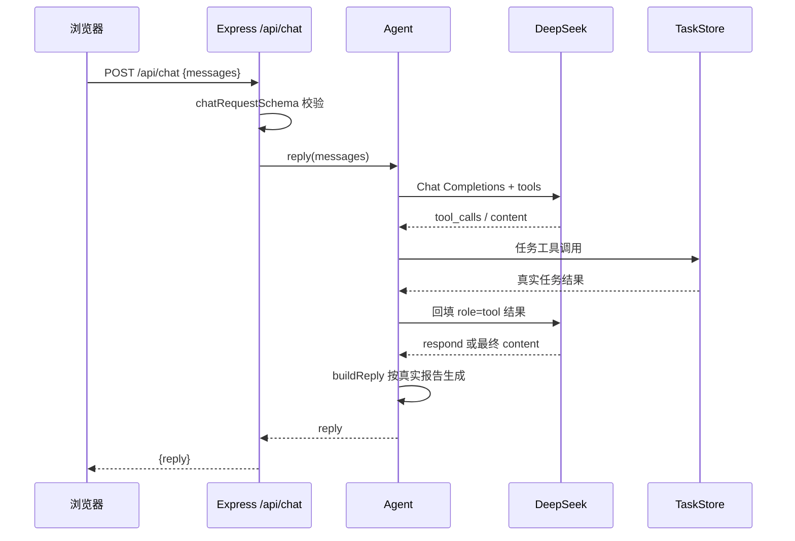

# Todo Agent 架构说明

本文档以当前代码为依据，说明 Todo Agent 的请求处理、DeepSeek 交互、工具协议、任务匹配、成功校验和错误兜底。

## 1. 系统整体架构

```mermaid
flowchart LR
  B[React Chat UI] -->|POST /api/chat| API[Express /api/chat]
  API -->|reply(messages)| Agent[Todo Agent]
  Agent -->|Chat Completions + tools| DeepSeek[DeepSeek API]
  DeepSeek -->|tool_calls / content| Agent
  Agent -->|list/create/complete/delete| Store[(TaskStore<br/>data/tasks.json)]
  Store -->|tasks| Agent
  Agent -->|reply| API
  API --> B

  Other[外部 API 客户端] -->|/api/tasks| REST[Task REST API]
  REST --> Store
```

两条链路：

1. **聊天链路**：浏览器 → `/api/chat` → Agent → DeepSeek / 工具 → 回复。
2. **任务 REST API**：外部客户端 → `/api/tasks` → `TaskStore`。

Agent 和 REST API 共用 `server/index.ts` 中创建的同一个 `TaskStore` 实例。Agent **不通过 HTTP 回环**调用任务 API，而是直接调用 `TaskStore` 方法。

相关文件：

| 文件                                 | 职责                                                  |
| ------------------------------------ | ----------------------------------------------------- |
| `server/index.ts`                    | 创建 `TaskStore`、Agent 和 Express app，启动服务      |
| `server/app.ts`                      | 请求校验、`/api/chat`、任务路由、静态资源、错误中间件 |
| `server/agent.ts`                    | Agent 核心逻辑                                        |
| `server/model.ts`                    | DeepSeek 客户端                                       |
| `server/tasks.ts`                    | 任务 REST API                                         |
| `server/task-store.ts`               | JSON 文件存储                                         |
| `shared/chat.ts`                     | 聊天消息类型与请求 schema                             |
| `src/App.tsx` / `src/chat-client.ts` | 前端聊天与请求封装                                    |

## 2. 用户请求处理流程

1. `src/App.tsx` 的 `send()` 将用户输入追加到 `messages`。
2. `src/chat-client.ts` 的 `requestReply()` 向 `/api/chat` 发送：

   ```json
   {
     "messages": [{ "role": "user", "content": "帮我记一下买牛奶" }]
   }
   ```

3. `server/app.ts` 的 `createApp()` 使用 `shared/chat.ts` 的 `chatRequestSchema` 校验：
   - `messages` 至少一条；
   - 每条只有 `user` / `assistant` 角色；
   - 最后一条必须是用户消息。
4. `createApp()` 调用注入的 `reply(messages)`；该函数由 `server/index.ts` 创建：

   ```ts
   const tasks = createJsonTaskStore(join("data", "tasks.json"));
   const app = createApp({ reply: createTodoAgent({ tasks }), tasks });
   ```

5. `createTodoAgent()` 返回的 `reply()` 构造模型历史：
   - system prompt；
   - 客户端发来的用户/助手文本。
6. Agent 进入工具循环，直到得到结构化结果或达到上限。
7. `server/app.ts` 返回 `{ "reply": "..." }`，前端把该文本追加为 assistant 消息。



客户端历史只保存 `user` / `assistant` 文本，不保存工具调用消息。工具调用只存在于服务端单次请求的上下文中。

## 3. Agent 与 DeepSeek API 的交互

### 3.1 客户端

`server/model.ts` 导出的 `getModelClient()`：

```ts
const apiKey = process.env.DEEPSEEK_API_KEY;
if (!apiKey) throw new Error("请在 .env 中设置 DEEPSEEK_API_KEY 后重启服务。");
return new OpenAI({ apiKey, baseURL: "https://api.deepseek.com" });
```

`agent.ts` 的 `modelClient()` 做惰性单例创建；只有真正发起模型请求时才要求 Key。

### 3.2 请求参数

`agent.ts` 的 `deepSeekModelCall()`：

```ts
const completion = await modelClient().chat.completions.create({
  model,
  messages,
  tools: TOOLS,
  tool_choice: "auto",
  reasoning_effort: "none",
});
```

- `model` 来自 `server/model.ts`，默认 `deepseek-flash`，可由 `DEEPSEEK_MODEL` 覆盖。
- `tools` 为下面第 4 节中的任务工具和 `respond` 工具。
- `tool_choice: "auto"` 由模型决定是否调用工具。
- `reasoning_effort: "none"` 关闭 thinking。原因：当前客户端历史只有文本，没有历史 `reasoning_content`；带 tools 的 thinking 请求要求回传该字段，否则可能返回 400。
- DeepSeek 客户端设置 60,000ms 超时（`server/model.ts`）；超时会走统一错误兜底。
- 当前未使用流式响应。

### 3.3 消息顺序

一次完整的工具调用循环中，服务端按以下顺序维护历史：

```text
system
user
assistant(tool_calls=[...])
tool(tool_call_id=..., content=工具结果 JSON)
assistant(tool_calls=[...])
tool(...)
...
assistant → respond 或最终文本
```

上一次 assistant 的 `tool_calls` 必须原样回填，随后为每个 `tool_call_id` 提供一条 `role: "tool"` 消息。服务端在 `agent.ts` 的循环中完成这些回填。

## 4. Tool Calling 机制

工具定义位于 `agent.ts` 的 `TOOLS`。

| 工具            | 参数                      | 作用                              |
| --------------- | ------------------------- | --------------------------------- |
| `list_tasks`    | 无                        | 返回任务标题和完成状态，不返回 id |
| `create_task`   | `title`                   | 创建任务                          |
| `complete_task` | `name`，可选 `occurrence` | 按名称完成                        |
| `delete_task`   | `name`，可选 `occurrence` | 按名称删除                        |
| `respond`       | `claimed_action`          | 结构化收尾                        |

### 4.1 模型如何决定调用

- system prompt 要求任务操作必须通过工具完成；
- 工具描述说明何时使用、参数含义和“不要传 id”；
- 模型返回 `message.tool_calls`；
- 服务端按顺序执行工具，不解析用户自然语言命令。

### 4.2 为什么不让模型传 id

`list_tasks` 只返回：

```json
{
  "tasks": [{ "title": "买牛奶", "done": false }]
}
```

模型看不到任务 id。`complete_task` / `delete_task` 的 schema 只接受 `name` 和可选 `occurrence`；服务端内部解析到真实 id 后再调用 `TaskStore`。

## 5. 工具执行流程

工具执行器为 `agent.ts` 的 `runTool()`。

```text
tool_call
  → 校验调用类型
  → 解析 JSON 参数
  → 按工具名分派
  → 校验参数
  → 访问 TaskStore
  → 重新读取确认结果
  → 生成 ToolReport
  → 序列化为 tool 消息
```

### 5.1 `list_tasks`

- 调用 `tasks.list()`；
- 将结果映射为 `{ title, done }`；
- 设置 `state.hasListed = true`；
- 返回成功报告。查询本身不会被当作数据修改。

### 5.2 `create_task`

- 复用 `server/tasks.ts` 的 `createTaskSchema` 校验标题（trim、1–200 字符）；
- 调用 `tasks.create(title)`；
- 再次 `tasks.list()`，确认新 id 存在；
- 只有确认成功才记录成功报告。

### 5.3 `complete_task` / `delete_task`

执行前检查：

- `state.hasListed` 必须为 true，否则返回 `not_listed`；
- `name` 通过 zod 校验；
- `findTaskCandidates(tasks, name)` 返回匹配候选。

匹配规则：

1. 规范化名称：`trim`、压缩空白、大小写归一；
2. 先找完全同名；
3. 没有完全同名时，只做**正向子串匹配**：`task.title.includes(query)`；
4. 0 个候选 → `not_found`；
5. 多个候选 → `ambiguous`，返回候选列表，不执行；
6. 多个候选时，只有用户在当前请求中明确说“第 N 条/个/项/件”，且传入的 `occurrence` 与用户表述一致，才选择对应候选；
7. 不做反向包含 `query.includes(title)`，避免短标题被更长的用户描述误命中。

执行后复核：

- 完成：`tasks.update(id, { done: true })`，重新读取确认 `done === true`；
- 删除：`tasks.remove(id)`，重新读取确认该 id 不再存在；
- 失败时返回 `store_error`，不会输出成功。

`occurrence` 的序号解析由 `parseOrdinal()` 完成，当前支持阿拉伯数字和中文一至十，并要求“条/个/项/件”等单位。

## 6. `respond` 工具协议

`respond` 是服务端定义的收尾工具，不是 DeepSeek 内置工具。

```json
{
  "claimed_action": "none | create | complete | delete | query"
}
```

`agent.ts` 的 `handleRespond()` 处理：

| `claimed_action` | 行为                                                                                   |
| ---------------- | -------------------------------------------------------------------------------------- |
| `none`           | 有任务报告时按真实报告生成回复；无报告时返回固定安全聊天文案                           |
| `query`          | 返回真实任务清单                                                                       |
| `create`         | 必须存在成功的 `create` 报告；否则回传 `not_executed` 错误，要求模型补调 `create_task` |
| `complete`       | 必须存在成功的 `complete` 报告；否则回传 `not_executed` 错误                           |
| `delete`         | 必须存在成功的 `delete` 报告；否则回传 `not_executed` 错误                             |

关键点：

- `respond` 本身不会修改任务；
- `claimed_action` 是模型的结构化声明，服务端用本轮真实工具报告校验；
- 声明与结果不一致时，错误会作为 `role: "tool"` 消息回给模型，模型可以补调真实工具；
- 用户可见的成功文本只由 `buildReply()` 根据工具报告生成。

### 6.1 模型只返回自然语言时

- 如果已有工具报告：`buildReply()` 根据真实报告生成回复，模型文本被忽略；
- 如果没有工具报告：追加 `RESPOND_REMINDER` 系统消息，要求模型调用 `respond` 或任务工具；
- 达到 `MAX_STEPS` 仍没有结构化结果：返回安全兜底，不转发模型自然语言；
- 无工具、无报告的 `respond none`：普通聊天返回固定 `CHAT_REPLY`；如果用户消息明显是待办请求，则返回 `task_required` 工具错误，要求模型补调任务工具，而不是静默结束。
- 已有报告但只有 `list`、没有修改类调用，而用户消息包含修改意图时，也会返回 `task_required`，要求模型补调创建/完成/删除工具。

这保证模型自然语言不会被当作成功依据。

## 7. list-before-mutate 机制

`ToolState` 每次 `/api/chat` 请求重新创建：

```ts
const toolState: ToolState = { hasListed: false };
```

只有 `list_tasks` 成功执行后，`hasListed` 才置为 true。`complete_task` 和 `delete_task` 在执行前检查该标志。

目的：

- 模型必须先获取最新清单；
- 降低使用过期任务信息的风险；
- 让“按名称匹配”基于当前真实数据。

该状态是**单次请求级别**，不会跨对话轮次保留；下一轮需要重新查询。

## 8. MAX_STEPS 与 MAX_TOOL_CALLS

定义在 `agent.ts`：

```ts
const MAX_STEPS = 6;
const MAX_TOOL_CALLS = 12;
```

### `MAX_STEPS`

限制单次 `/api/chat` 请求中的模型调用轮数。达到上限后：

- 如果已有工具报告，返回真实执行汇总 + 上限说明；
- 如果没有报告，返回安全兜底。

### `MAX_TOOL_CALLS`

在“执行一批工具调用之前”检查：

```ts
if (toolCalls + calls.length > MAX_TOOL_CALLS) {
  return buildReply(reports, tasks, "已达到单轮工具调用上限...");
}
```

- 超出上限的批次不会执行；
- 之前已成功执行的工具仍会在汇总中如实展示；
- 不会把未执行的操作写成成功。

## 9. 错误处理与安全兜底

### 9.1 错误类型

`ToolReport` 记录 action、成功标记、标题、错误码、候选任务等。主要错误码：

| 错误码             | 场景                                               |
| ------------------ | -------------------------------------------------- |
| `invalid_json`     | 工具参数不是合法 JSON                              |
| `invalid_title`    | 创建标题为空或超过 200 字符                        |
| `invalid_name`     | 缺少任务名称，或模型传入 id 等非法字段             |
| `not_listed`       | 完成/删除前没有查询                                |
| `not_found`        | 没有匹配任务                                       |
| `ambiguous`        | 同名或相似候选过多                                 |
| `store_error`      | 读写任务存储失败或结果无法确认                     |
| `unknown_tool`     | 模型调用了未定义工具                               |
| `not_executed`     | `respond` 声明了操作，但本轮没有对应的成功工具结果 |
| `invalid_response` | `respond` 参数不是合法 JSON 或不符合 schema        |
| `task_required`    | 任务请求以 `respond none` 结束，需要先调用任务工具 |

其中 `not_executed` 和 `invalid_response` 会作为回给模型的工具错误内容出现。

### 9.2 模型与存储异常

- 缺少 `DEEPSEEK_API_KEY`：`modelErrorReply()` 返回配置提示；
- 模型请求失败或超时（客户端超时 60 秒）：有工具报告时返回报告汇总，否则返回“模型服务暂时不可用”；
- JSON 解析失败、未知工具、任务写入/读取异常：转为结构化错误，不直接让 `/api/chat` 500；
- `/api/tasks` 的存储异常仍由 Express 错误中间件处理（通常为 500）。

### 9.3 防止虚报成功

- 创建后重新读取确认；
- 完成后重新读取确认 `done === true`；
- 删除后确认 id 不存在；
- `buildReply()` 只为 `ok: true` 的工具报告输出成功文本；
- 模型文本不参与成功判定；
- `respond` 声明必须与真实工具报告一致。

### 9.4 已知边界

- 模型可能偶发不调用任务工具。服务端不会虚报成功，任务请求会尝试返回 `task_required` 要求补调工具，但该次操作仍可能不会执行；这是已接受的非阻塞风险。
- 单条相似任务仍可能在“唯一正向子串匹配”时被直接选中；多条候选会要求确认。
- DeepSeek 客户端有 60 秒超时；超时只返回通用错误，没有针对超时的重试/恢复策略。
- 纯聊天无模型自由回复，返回固定安全文案。

## 10. 任务 REST API 与 Agent 的关系

`server/app.ts` 挂载 `/api/tasks`，由 `server/tasks.ts` 处理：

- `GET /api/tasks`
- `POST /api/tasks`
- `PATCH /api/tasks/:id`
- `DELETE /api/tasks/:id`

这些接口使用 `TaskStore`，与 Agent 共用同一实例。`server/openapi.yaml` 是 REST API 的契约文档。

差异：

- REST API 对外暴露任务 id；
- Agent 工具不向模型暴露 id，由服务端按名称解析；
- Agent 额外提供 `respond` 和“先查询再修改”等约束；
- REST API 支持修改标题（PATCH），Agent 当前只暴露四个核心操作。

## 11. 当前实现边界

以下能力目前**没有**实现，文档不应表述为已支持：

- 截止日期、子任务、优先级/工作量；
- 流式响应；
- 多用户、登录、鉴权、速率限制；
- 数据库/多进程并发存储；
- 撤销删除、操作历史；
- CI 和浏览器自动化测试；
- License 文件。

## 12. 代码与测试索引

| 主题          | 代码                                                          |
| ------------- | ------------------------------------------------------------- |
| Agent 主循环  | `server/agent.ts` 的 `createTodoAgent()`                      |
| 模型调用      | `server/agent.ts` 的 `deepSeekModelCall()`、`server/model.ts` |
| 工具执行      | `server/agent.ts` 的 `runTool()`                              |
| 名称匹配      | `server/agent.ts` 的 `findTaskCandidates()`、`parseOrdinal()` |
| 收尾协议      | `server/agent.ts` 的 `handleRespond()`                        |
| 最终回复      | `server/agent.ts` 的 `buildReply()`                           |
| 错误提示      | `server/agent.ts` 的 `modelErrorReply()`                      |
| 任务存储      | `server/task-store.ts`                                        |
| 任务 REST API | `server/tasks.ts`                                             |
| 前后端协议    | `shared/chat.ts`                                              |
| Agent 测试    | `server/agent.test.ts`（40 个）                               |
| API 测试      | `server/app.test.ts`（4 个）                                  |
